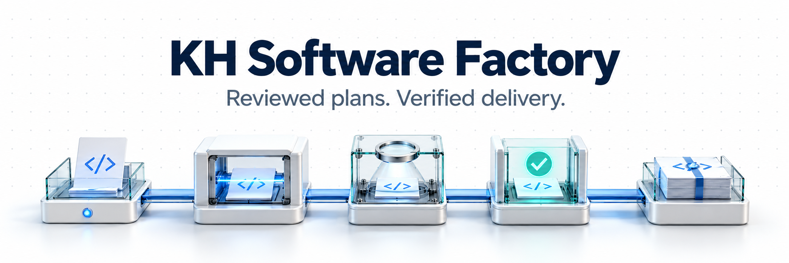
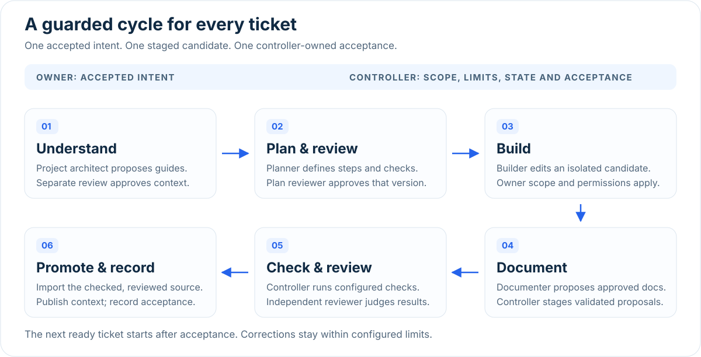

# KH Software Factory



[](https://github.com/khaled1174/KH-Software-Factory/actions/workflows/verify.yml) [](https://github.com/khaled1174/KH-Software-Factory/releases/latest)

**A local workflow controller for AI-assisted software development.** Coordinate Claude Code and Codex through reviewed plans, scoped implementation, real checks and independent review. The controller records acceptance only after the required gates pass.

[Start here](START_HERE.md) · [18 commands](COMMANDS.md) · [Architecture](docs/ARCHITECTURE.md) · [Download](https://github.com/khaled1174/KH-Software-Factory/releases/latest) · [Arabic guide](START_HERE_AR.md)

## One guarded cycle per ticket



Run a recorded project plan with `/kh-project run-continuous`. Tasks execute sequentially; dependencies unlock after acceptance. Corrections retain scope, permissions, deadlines and attempt limits.

## What you get

| Capability | How it works |
| --- | --- |
| Reviewed understanding | Current project guides and an independently reviewed plan. |
| Scoped implementation | Isolated candidates, approved paths and protected-file checks. |
| Real verification | Configured commands and independent review of the checked changes. |
| Recorded evidence | Source fingerprints, phase traces and acceptance receipts. |
| Bounded recovery | Retained work and corrective rounds under configured limits. |
| Owner-selected models | Claude Code or Codex, with model and effort recorded per role before a run. |
| Local visibility | Optional trace UI with token and cost reporting. Costs remain informational. |

## Clear roles, one acceptance controller


Role models submit proposals and evidence. The controller owns ordering, scope, checks, source promotion and task completion. [See the roles and their entry points](docs/ARCHITECTURE.md#role-ownership).

## Start with your project

Download and unpack the [complete release](https://github.com/khaled1174/KH-Software-Factory/releases/latest), then preview and install:

```bash
python3 install.py --project "/absolute/path/to/project" --dry-run
python3 install.py --project "/absolute/path/to/project"
```

Configure real quality commands and record each role's model with `/kh-setup-models`. Follow [START_HERE.md](START_HERE.md) to accept an intent, prepare project context and run your first task. For existing installations, read its backup, upgrade and restore instructions first; differing project configuration and role prompts are preserved.

## Verification and boundaries

The release gate checks an extracted ZIP with the full suite, contract evaluations and installer smoke checks. [Verification and known limits](docs/VERIFICATION.md) explain what those results establish. Native CLI permissions and the quality floor remain acceptance constraints. The trace UI observes work and cannot execute or approve it.

[CHANGELOG.md](CHANGELOG.md) describes version 1.0.0. [Source attribution](docs/THIRD_PARTY.md) and the [integration register](docs/Skills_Integration_Register.md) identify sources, licenses and responsibilities. No credentials, model sessions or dependencies are bundled.
