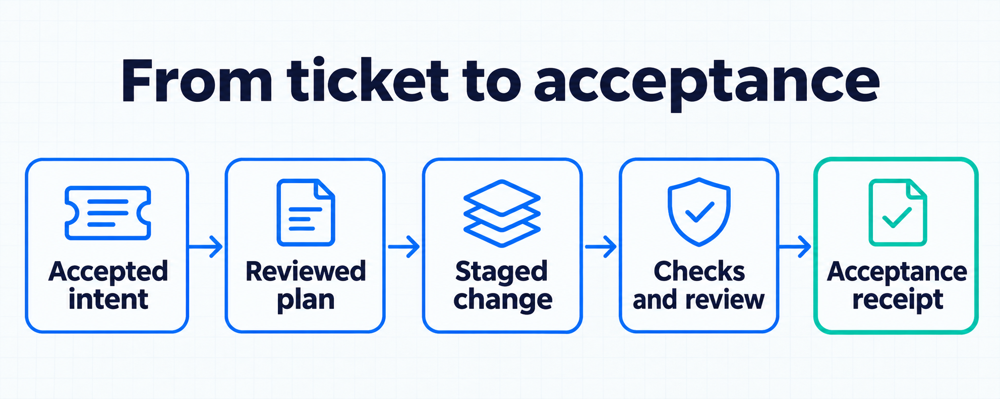
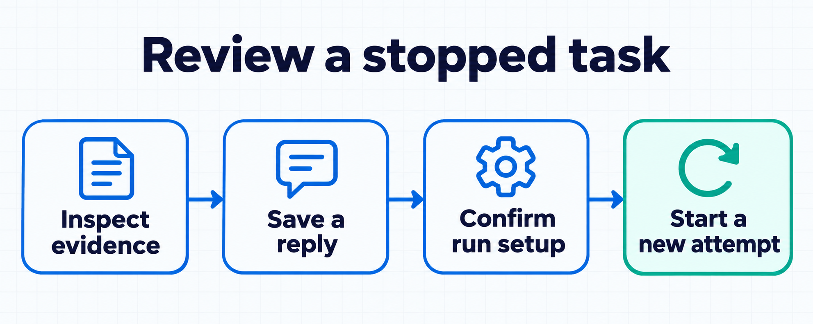

# KH Software Factory

**A local workflow controller for Claude Code and Codex.** Take a coding ticket through a reviewed plan, scoped implementation, real checks, and independent review. KH records the evidence behind every accepted change.

[](https://github.com/khaled1174/KH-Software-Factory/actions/workflows/verify.yml) [](LICENSE)

[Start here](START_HERE.md) · [Arabic guide](START_HERE_AR.md) · [Commands](COMMANDS.md) · [Architecture](docs/ARCHITECTURE.md) · [Tagged releases](https://github.com/khaled1174/KH-Software-Factory/releases)

## What KH verifies



- **Scope.** The builder works in a staged copy with an approved file scope. KH measures the resulting changes before allowing promotion.
- **Checks.** KH runs the project's configured commands on the candidate and records their results.
- **Review.** An independent reviewer examines the controller-measured diff and the original requirements. For tracked tickets, the controller writes the acceptance receipt after the required checks, review, and promotion succeed.

Run a single task with `/kh-start` or execute a recorded plan sequentially with `/kh-project run-continuous`. A dependent task becomes ready when the controller accepts all of its prerequisites.

## Working methodology


The planner proposes the scope and steps. A separate reviewer approves the exact plan version. The controller runs the checks and applies the independent review result. Repairable findings return to the builder within the configured limits. A run stops with evidence if it needs an owner decision or exhausts its limits. [Detailed workflow](docs/ARCHITECTURE.md#workflow-diagram)

## Inspect a stop and respond



The optional local visualizer shows the stopped attempt, recorded checks, reviewer findings, and the published diff when available. With local actions enabled, you can reply to the task or a line, confirm the saved role setup, and follow the next guarded attempt from the same page.

Export a Markdown delivery packet for an attempt. For accepted work, the packet records the receipt and source fingerprints. The [visualizer guide](START_HERE.md#optional-trace-ui) explains local activation and includes a deterministic demo.

## Install and run your first task

Use macOS, Linux, or WSL2 with Ubuntu. Install Python 3.10+, Git, and `uv`, and sign in to Claude Code. Linux and WSL2 also use `bubblewrap` and `socat`. [Requirements](START_HERE.md#requirements)

[Download the current source ZIP](https://github.com/khaled1174/KH-Software-Factory/archive/refs/heads/main.zip) and unpack it. From that folder, preview and run the installer.

```bash
python3 install.py --project "/absolute/path/to/project" --dry-run
python3 install.py --project "/absolute/path/to/project"
```

Configure your quality commands, record role choices with `/kh-setup-models`, and prepare one scoped ticket. [First task and upgrade guide](START_HERE.md)

## Verification and limits

KH runs locally and uses the coding CLIs' native permissions. Its acceptance record describes the tested candidate and the checks actually configured for it.

The release gate verifies file hashes and reruns tests, contract evaluations, and an installer smoke test from the extracted ZIP. [Verification record](docs/VERIFICATION.md) · [CHANGELOG.md](CHANGELOG.md) · [License](LICENSE)
