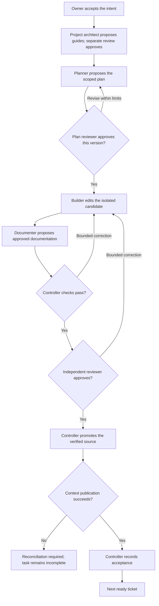
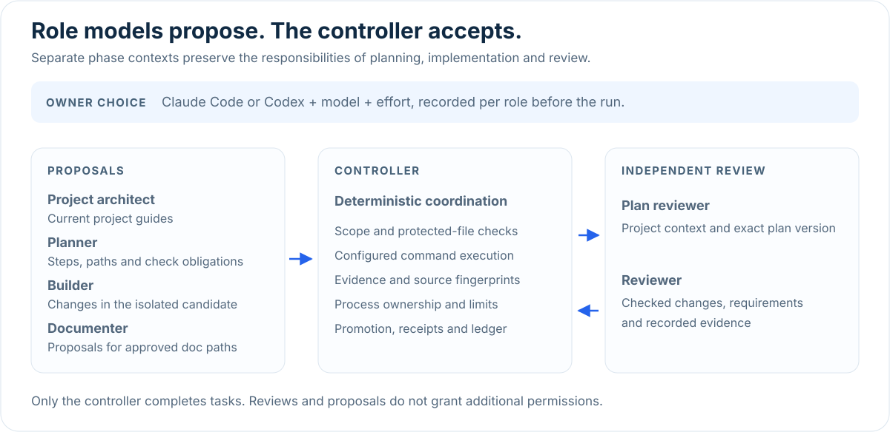

# KH architecture

The controller owns task state, retries, ordering, scope, checks and acceptance.
Role models propose typed results in separate phase contexts. Transports carry
those requests; supporting skills cannot approve work or become a second
scheduler. Owner intent, native permissions and the quality floor remain binding.

## Task lifecycle

| Stage | Result and boundary |
| --- | --- |
| Intent | Owner accepts the exact request and constraints; text identity is checked. |
| Understanding | Read-only architect proposes current guides; separate review approves them. |
| Planning | Scope, ordered steps, check obligations and documentation targets receive exact-version review. |
| Build | The builder writes an isolated candidate within the existing role boundary. |
| Documentation | A read-only documenter proposes changes to exact approved targets. |
| Verification | Actual configured commands run on the complete staged candidate. |
| Review | An independent read-only reviewer assesses actual changes, requirements and evidence. |
| Repair | Existing bounded corrections recheck changed source and carry earlier findings forward. |
| Promotion | The unchanged checked/reviewed candidate imports against the original owner baseline. |
| Completion | Derived context publishes, then the saved receipt completes the ledger task. |

An agent's SUCCESS, a check's zero exit or an approved plan alone is insufficient.
Source promotion and context publication are separate filesystem steps; a
publication failure is recorded for reconciliation rather than called complete.
See the installed [planning](../.claude/skills/kh/references/reviewed-planning.md),
[intent](../.claude/skills/kh/references/intent.md) and
[project ledger](../.claude/skills/kh/references/project-tracking.md) contracts.

## Workflow diagram



Corrections remain inside configured deadlines and attempt limits. Exhausted
limits, unresolved checks or missing approval stop acceptance. Source promotion
and context publication are distinct steps; a failed publication requires
reconciliation rather than a completed task.

## Role ownership



| Role | Produces or assesses | Entry point |
| --- | --- | --- |
| Project architect | Current project guides from observed source | `/kh-bootstrap`; preparation before guarded execution |
| Plan reviewer | Independent context review and approval of an exact plan version | `/kh-bootstrap`, `/kh-plan-review`, guarded execution |
| Planner | Scope, ordered steps, check obligations and documentation targets | `/kh-plan-review`, `/kh-start` |
| Builder | Source changes in an isolated candidate | `/kh-start` or a ticket selected by `run-continuous` |
| Documenter | Read-only proposals for approved documentation paths | Closing phase of guarded execution; `/kh-document` for standalone documentation |
| Reviewer | Checked changes, requirement coverage and recorded evidence | Independent review in the guarded cycle |
| Controller | Ordering, checks, limits, source promotion and acceptance receipts | Python runtime; no model is assigned to this responsibility |

The owner records a supported CLI transport, model and effort for each model
role with `/kh-setup-models`. Separate phase contexts retain role independence
even when roles share a model. A standalone command's proposal or approval does
not complete a ledger task. The controller remains the acceptance authority.

## Current context and closing documentation

Current project guides live in docs/agent-guide/ and historical change records
in app_docs/. Root and nested instructions retain mandatory applicability.
The controller selects active guides; reviewed read_when conditions require
reasoned read/skip decisions for every conditional guide. Selected bytes bind
the exact plan and handoff. History does not become active context merely by
existing. Root human CHANGELOG is excluded from observed agent inputs.

The controller derives configured command facts and the conditional catalog;
the architect proposes guides rather than those derived files. Deterministic
derivation does not prove that a command ran. Active scoped guides bind observed
source content through source_digests and source_proofs. General unscoped or
universal navigation keeps existing structure-based freshness. Document bytes,
manifests, structure and owner edits retain their separate checks.

Affected scoped guides return to the existing documenter. Reviewed updates or
digest-bound confirmed_documents can establish a new source binding; a
confirmation cannot change text or metadata. Disabled or not-needed documentation
does not silently refresh a stale binding. Warm unchanged context makes no
architect call. The renewal prompt excludes the root README, so old prose there
cannot be copied merely as a renewal input. This does not exclude README from
every other role or make it a content-tracked scoped guide.

The plan's documentation.paths is the exact authorized target set.
documents[].path must match it exactly. The controller supplies documented_paths
from measured changed paths; the model does not invent the changed-file set.
Candidate identity, source proofs, target paths, lifecycle and owner baseline
are validated before staging and again at projection/promotion boundaries.
These checks establish delivery/freshness contracts, not general semantic truth.
Active operating guides that list both `Run:` and `Tests:` instructions must
reference the configured required build command, a defined root `make build`
target, or the controller-generated commands guide. The same deterministic
check returns findings to the architect and documenter within their existing
correction limits. It runs no build command or model. Optional or undeclared
builds, historical records and unrelated feature guides retain their contracts.
This is bounded command coverage, not free-form semantic claim verification:
other heading conventions, arbitrary aliases and contradictory surrounding
prose require independent review. The fixed corpus still misses three semantic defects; see
[verification](VERIFICATION.md#not-verified).
The full installed [context reference](../.claude/skills/kh/references/project-context.md)
defines fields, source limits, preservation, review continuity and recovery.

## Sequential execution

run-continuous executes one staged owner cycle per ready ticket, under one
repository lease. Each ticket retains reviewed planning, bounded implementation,
configured checks, documentation and an independent review before promotion.
Dependencies unlock only after acceptance in the authoritative SQLite ledger.
There are no parallel ticket workspaces, candidate imports or integration review reuse.
Ordinary task and role staging remains isolated.

Stale navigation is refreshed and independently reviewed before planning.
Existing saved-work review and bounded builder continuation retain their gates.
Required native test commands remain builder capture obligations, checked for
compatibility at plan validation. The exact owner-granted command grammar and
process-local DB overrides are defined in the installed
[test-command permissions](../.claude/skills/kh/references/test-command-permissions.md).
No container or database-server configuration change is authorized.

Historical parallel directories, execution decisions and metadata are refused
before dispatch with LEGACY_PARALLEL_STATE. Their contents are left unchanged.
Reconcile incompatible saved state explicitly; it cannot silently become
sequential authority. Read-only ledger inspection remains available.

## Transports, resources and evidence

The [delegation reference](../.claude/skills/kh/references/delegation.md) specifies
Codex relay validation, usage accounting and
provider limitations. A transport result is distinct from source acceptance.
Private subprocess ownership tracks descendants and readers; normal completion,
timeout and cancellation must settle their owned resources. Unobserved processes
that remove ownership tags retain the documented best-effort limitation.
Working-copy scope enforcement is not an operating-system/network sandbox.

Phase evidence and changed-file claims are checked on final cleaned bytes.
Native terminal completion and evidence sealing do not grant task acceptance.
Failed attempts keep their outcome and partial usage. Claude cumulative-session
usage is differenced rather than added repeatedly; subscription billing is not
inferred from estimated query prices. Failed attempts retain their trace and
partial usage. Cost is information, never a stopping threshold.

The local trace UI reads existing events and project reports. It can archive a
session's review flag but cannot dispatch or approve. Missing history remains
unknown; a fetched snapshot is not proof that an agent is alive.
See [observability](../.claude/skills/kh/references/observability.md).

## Offline intervention reporting

The distribution inspector prints a stop baseline and blocker report for an
explicitly selected project:

```bash
python3 -B scripts/report_interventions.py --root "/path/to/project"
python3 -B scripts/report_interventions.py --root "/path/to/project" --format json
```

It reads `.kh/project.db` and default
`adws/adw_data/sessions/*/events.jsonl` journals. It does not search other
projects, custom data directories, environment files or provider output streams.
It starts no process or model, imports no runtime, and writes no project files.
This maintenance inspector is not an installed slash command or a controller.

Use a quiescent offline project. SQLite reads use a private temporary copy;
nonempty WAL/rollback journals, symlinked inputs and nonregular files are refused.
Corrupt inputs exit 2 with an error and no partial report. Input bytes and
modification times are preserved. Unchanged inputs produce deterministic JSON.

Each ledger `blocked` or `recovered` event counts as one recorded stop. A guarded
terminal journal error adds a stop only if that run has no ledger stop. Repaired
role errors and gate failures are excluded. These counts do not measure human
interventions; `human_interventions` remains null.

| Cause | Explicit recorded signal |
| --- | --- |
| `owner_decision` | `OWNER_DECISION_REQUIRED` or `OWNER_REVIEW_REQUIRED` |
| `permissions` | A role's prohibited-path rejection |
| `quality` | Failed role gates, saved review/checks, plan revision or changed verification source |
| `environment` | `INFRA_OR_PROVIDER_BLOCKER` or `INFRA_BOUNDARY` |
| `interruption` | Ledger `recovered` event |
| `limits` | Explicit budget, deadline, role timeout or no-progress stop |
| `unknown` | No recognized controller marker |

Each stop retains task/run identity, reason, timestamp, evidence location and
SHA-256. A matching journal can supply the failed phase, gate and violations;
unrelated or absent evidence cannot. Affected files are never inferred from the
allowed paths. Required actions point to existing correction, acceptance or
recovery paths without approving work, expanding permissions or resetting limits.
Existing `report`/`hold`, notification failure and acceptance behavior is unchanged.

`open_blockers` follows current ledger state; successful retries retain history
without an open blocker. Without a ledger, current task state is unknown. Missing
stop history for a blocked task marks coverage partial and retains its snapshot.
Missing history uses null counts; an initialized unstarted project has zero
recorded stops. Unknown history is never reconstructed from guesses.

Custom data paths, pre-session failures and unrecorded manual actions are outside
this baseline. A zero observed count does not prove no human work occurred.
Evidence links are local; reports can contain private paths and recorded messages
and should remain with their project.

## Reproduce the measured scope

```bash
python3 -B tests/test_next_call_counts.py --benchmark-contexts /tmp/kh-bench.json
```

KH_NEXT_BENCHMARK_ROOT selects an extracted comparison source. The same fixture
uses real Python/Git/SQLite/process boundaries with a deterministic provider.
The retained legacy workload dispatches 10 calls cold and 8 warm. Warm
preparation is measured separately; these counts are neither universal budgets
nor prices. Unit regressions still cover sequential documentation freshness.

Current CI artifacts bind measurements to runtime and fixture hashes. Offline
cleanup, resume and acceptance tests do not establish general model quality,
subscription compatibility or universal speed gains.
